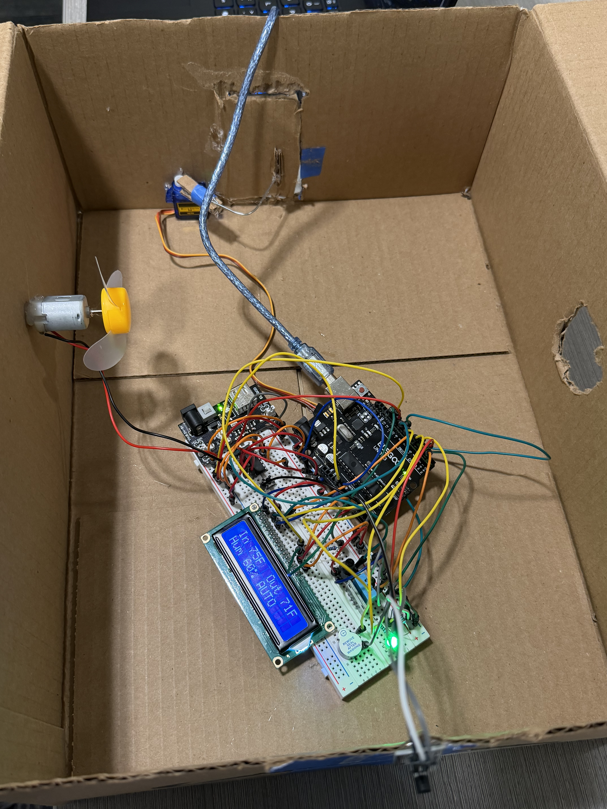

# Heat Station

A heat safety station for dorm rooms, built in about a day and a half at **IEEE HackIoT 2026** at USC (Oct 24 to 25). The theme was sustainability.

It measures how hot a room *feels*, warns people before it gets dangerous, and cools the room the cheapest way it can: if it's cooler outside, it opens a vent instead of running the fan (our stand-in for AC).




## Why we built it

Is 90°F safe? It depends on humidity. At 40% humidity, 90°F feels like 91°F. At 80%, it feels like 113°F, which is heat stroke territory. A normal thermometer can't tell those apart.

On top of that, most cooling is dumb. AC keeps running even when opening a window would do the job. We wanted a box that knows the real risk and picks the greener option on its own.

## What it does

- Reads indoor temperature and humidity and calculates the **heat index** (the National Weather Service formula)
- Shows a color for the risk level: green, yellow, orange, red
- Prints "DRINK WATER" on the LCD and beeps when it gets dangerous
- When the room needs cooling, compares inside vs. outside temperature
  - outside at least 3°F cooler: servo opens the vent, fan stays off
  - otherwise: fan runs, faster as it gets hotter
- Sends a reading every 2 seconds to a laptop dashboard with a live chart, manual controls, and an estimate of energy saved
- Optional: phone alerts (ntfy) and a short plain-English room summary from the Claude API

## Hardware

| Part | Job |
|---|---|
| Elegoo UNO R3 | the brain |
| DHT11 | indoor temperature + humidity |
| DS18B20 module | outside temperature |
| LCD1602 + 10k potentiometer | display (pot sets contrast) |
| RGB LED + three 220Ω resistors | risk color |
| Active buzzer | alarm |
| Push button | short press mutes, long press switches thresholds |
| L293D + small DC motor with fan blade | "AC" |
| SG90 servo + cardboard flap | the vent |
| Breadboard power module + 9V battery | separate power for the motor and servo |

## Wiring

| Arduino pin | Connected to |
|---|---|
| 2 | DHT11 signal |
| 3, 5, 6 | RGB LED red, green, blue (each through 220Ω) |
| 4 | buzzer + |
| 7, 8 | LCD RS, E |
| 12, 13, A1, A2 | LCD D4, D5, D6, D7 |
| 9 | servo signal |
| 10 | L293D pin 2 |
| 11 | L293D pin 1 |
| A0 | DS18B20 signal |
| A3 | button (other leg to GND) |

Power layout, which took us a while to get right:

- **Top rails = Arduino 5V/GND.** LCD, pot, sensors, LED, buzzer, button, L293D pin 16.
- **Bottom rails = power module 5V.** Only L293D pin 8 (motor power) and the servo.
- **One wire joins the two GND rails.** The two 5V rails are never connected.

The motor's two wires go to L293D pins 3 and 6. Pins 4, 5, 12, 13 and 7 go to ground.

## Running it

**Arduino**
1. Install the libraries: "DHT sensor library" (Adafruit), "Adafruit Unified Sensor", "DallasTemperature", and "OneWire".
2. Open `heat_station/heat_station.ino` and upload.
3. Serial Monitor at 9600 baud should show one JSON line every 2 seconds.

**Dashboard**
```
cd bridge
pip install -r requirements.txt
python bridge.py
```
Open http://localhost:8000. Close the Arduino Serial Monitor first, since only one program can use the port. `python bridge.py --fake` runs a simulator if the hardware isn't plugged in.

For the room summary, set your key in the same terminal before starting the bridge:
```
set ANTHROPIC_API_KEY=your-key        (Command Prompt)
$env:ANTHROPIC_API_KEY="your-key"     (PowerShell)
```

## How the energy number works

It's an estimate. The bridge counts how many minutes the vent is open, then multiplies by a typical 1 kW window AC: 30 minutes of vent = 0.5 kWh not used. CO₂ uses an assumed 0.5 lb per kWh. Both numbers can be changed with `--ac-kw` and `--co2-lbs-per-kwh`. A real version would measure power with a smart plug.

## What I learned

Most of the weekend was debugging hardware, and that's where I learned the most.

**Breadboards.** I didn't really get how they connect until I had to. Each numbered strip of 5 holes is connected, the center gap splits them, and a wire only connects to a part if it's in the same strip *on the same side of the gap*. The potentiometer's legs are in a triangle, not a line, which confused me for a while.

**An LCD showing a row of boxes is actually good news.** It means power and contrast are fine but the Arduino isn't talking to it. That narrowed it down to the six signal wires instead of all sixteen.

**Chip orientation matters.** I wired the L293D with pins 1 to 8 on the wrong side, so everything was mirrored. The fan spun even when the code said it was off. Pin 1 is next to the notch, and the numbers go down that side and back up the other.

**Motors need their own power, and grounds have to be shared.** When the motor and the Arduino were fighting over the same 5V rail, the board kept resetting and the screen flashed. Splitting the power fixed it, but the fan only listened to the Arduino once both grounds were connected. A signal only means something relative to a shared ground.

**Moving power around breaks things you already fixed.** After rearranging the power rails, the outside sensor stopped working because its rail had lost power. Moving it to the rail the DHT11 used fixed it instantly.

**Read the data before touching wires.** Printing the state as JSON every 2 seconds saved us a lot of time. If the serial output said `"fan":0` but the fan was spinning, it was a wiring problem, not code. If it said `"fan":78` and nothing spun, it was power.

**Humidity barely matters below 80°F.** Breathing on the sensor pushed humidity to 90% but the heat index only moved a couple of degrees, because the formula is much flatter when it's cool. We lowered the demo thresholds so it works in an air-conditioned room.

**Small stuff:** libraries have dependencies (OneWire), Arduino pins can't drive a motor directly, and a 9V battery dies fast with a motor on it.

## Limitations and next steps

- The DHT11 is about ±2°C. A DHT22 or SHT31 would be better and needs almost no code change.
- It only compares temperature. Opening a vent when it's cooler but smoky (fire season) or very humid outside isn't great. An air quality sensor is the obvious next part.
- The code already supports a PIR motion sensor (`USE_PIR` in the sketch) so it can skip cooling empty rooms. We didn't get one wired in time.
- Swap the UNO for an ESP32 so each room can report over Wi-Fi without a laptop.

## Team

Built at IEEE HackIoT 2026 by:
- Man Dang ([@ManDanggg](https://github.com/ManDanggg))
- Linh Phan
- Logan Shi 
- Nathan Choi 


